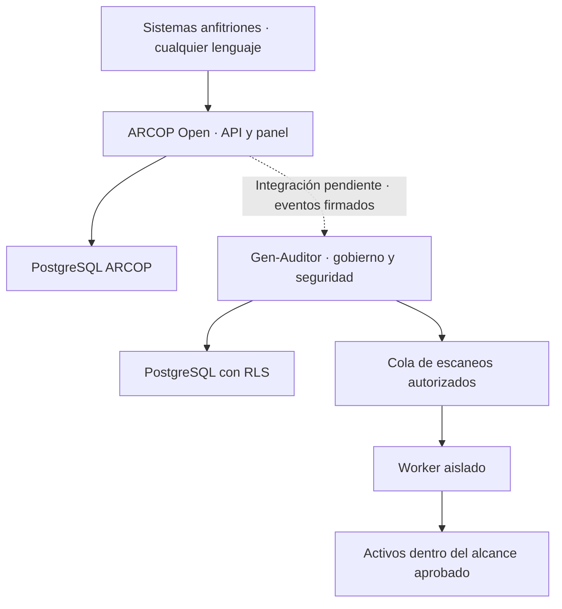

# Especificación técnica · Gen-Auditor y su relación con ARCOP Open

## 1. Dos productos, una integración explícita

| Producto | Responsabilidad | Instalación | Dependencia del otro |
| --- | --- | --- | --- |
| ARCOP Open | Recepción/tramitación de derechos, evidencia de decisiones y ejecución acreditada por el anfitrión | Servicio HTTP + panel embebible, con PostgreSQL y OIDC | Ninguna |
| Gen-Auditor | Gobierno, evaluación de controles, gestión de riesgos/incidentes y evaluación de seguridad | Aplicación React + API Node + PostgreSQL/Supabase | Opcional: consume evidencias de ARCOP |
| Paquete Composer histórico | Panel Blade del ciclo municipal existente | Laravel + muni-shared | Se conserva; no se convierte silenciosamente en el SaaS |

El lenguaje del anfitrión no determina el de ARCOP. Un sistema Python o Java consume HTTP/JSON o incorpora un iframe autenticado; no instala PHP ni React en su backend. Gen-Auditor no contiene las decisiones legales del paquete municipal. La aplicación nueva tiene licencia MIT por carpeta; las dependencias tienen sus propias licencias.

## 2. Contextos y componentes

- **Interfaz:** React, Vite, Tailwind, iconos Lucide. Sidebar oscuro colapsable; tarjetas claras; tipografía de sistema; verde petróleo para acciones, ámbar para revisión y rojo para criticidad. Responsive y navegación móvil.
- **Identidad:** Supabase Auth con JWT asimétrico/JWKS, issuer/audience/algoritmo verificados y MFA. No confiar en role/tenant enviados en un JWT personalizado sin validación de membresía en BD.
- **API:** Express, validación Zod estricta, cuerpo acotado, rate limit y errores sin datos SQL/PII. Bearer en memoria; no cookies de sesión de aplicación ni tokens en URL.
- **Persistencia:** esquema `gen_auditor`, rol dedicado no owner/no BYPASSRLS; cada operación usa transacción y contexto local. Esquema ARCOP completamente separado.
- **Trabajos:** chequeo HTTPS síncrono acotado en esta versión; worker Nmap opcional por tenant. Para escala, trasladar chequeos pasivos a cola con leases y límites por cliente, conservando semántica de auditoría.
- **Informes:** PDFKit, snapshot acotado, SHA-256 del PDF y firma Ed25519 del manifiesto. Almacenamiento privado; descargas autenticadas y auditadas.
- **Evidencias externas:** repositorio de objetos privado, versionado y retención/holds diseñados; aún no implementado. No aceptar rutas arbitrarias de disco de un cliente.

## 3. Vistas y comportamiento

### Dashboard

Ocho indicadores calculados desde BD: controles ISO verificados, riesgos abiertos, hallazgos abiertos, vencimientos futuros a 60 días, eventos, actores activos a 30 días, anomalías abiertas e integridad local de auditoría. Conjunto de controles vacío muestra «sin medición», nunca 100 %.

El porcentaje es `verificados / controles declarados aplicables`. Pendientes y evidencia sin revisar cuentan en el denominador; no aplicables se excluyen. No mide todos los requisitos de ISO, no certifica ni reemplaza una declaración de aplicabilidad. Un catálogo vacío o incompleto debe identificarse como tal.

El panel lateral de Ley 21.663 muestra estados de controles declarados. Exportar genera un informe ejecutivo del cliente seleccionado, no un certificado. El botón de firma usa la expresión «sello técnico» para no confundirla con firma avanzada.

### Protección de datos

- Tarjetas ARCO/portabilidad enlazan al **servicio ARCOP independiente** cuando ARCOP_PANEL_URL está configurado.
- Consentimientos: propósito, cliente/producto, versión de texto, fecha y SHA-256. Identidad pseudonimizada en listados; PII cifrada. El hash del texto prueba correspondencia, no que el titular lo haya aceptado libremente.
- Registro manual: IP y user agent corresponden al contexto de captura del operador/API, **no se atribuyen automáticamente al titular**. Un colector externo requiere prueba de origen y contrato de evidencia propios.
- Retiro: evento adicional. Debe propagarse a sistemas de tratamiento; el evento no detiene por sí mismo marketing, perfiles u otros procesos.
- Buzón: proyección de solicitudes externas; no duplicar workflow ni decidir desde Gen-Auditor.
- EIPD: borradores y revisión experta; no «EIPD aprobada automáticamente».
- Anonimización: propuesta de método/dataset. No ejecutar borrados ni declarar anonimato sin pruebas de reidentificación y revisión del responsable.

### Seguridad externa

Clientes con dominios, alta mediante Enter, desafío TXT de un solo valor, estado/antigüedad de verificación y chequeos HTTPS. El score de 0–100 es **higiene de cabeceras observadas**. No equipararlo a severidad CVSS o probabilidad de compromiso.

No seguir redirects: un cambio de destino requiere revisión. Una prueba fallida no recibe score 100. No inferir ausencia de vulnerabilidades de ausencia de hallazgos. Los hallazgos requieren estado, evidencia, responsable, fecha y retest.

## 4. Ciberseguridad: alcance de la suite, por capas

| Área | Producto esperado | Estado de esta entrega |
| --- | --- | --- |
| Gobierno y controles | Catálogo versionado, aplicabilidad, responsables y evidencia | Catálogo versionado y snapshots de cumplimiento implementados; dashboard inicial |
| Riesgos e incidentes | Registro, decisiones, etapas y compromisos | Modelo/API; envíos oficiales no implementados |
| Superficie externa | DNS, TLS/cabeceras y dominios autorizados | Implementado, pendiente aceptación en red real |
| Puertos externos | Inventario activo acotado por alcance | Worker Nmap opcional implementado, no ejecutado aquí |
| **Inventario de activos** | **Clasificación, criticidad, CIA, entorno y exposición** | **Implementado** (`assets`, `asset_endpoints`); el activo hereda la autorización de su dominio |
| **Ciclo de remediación** | **Plan, responsable, plazos, pasos y evidencia** | **Implementado** (`remediation_plans`, `remediation_steps`) |
| **Verificación posterior** | **Retest con revisor independiente y cierre o reapertura** | **Implementado** (`verification_runs`, `close_finding`, `reopen_finding`) |
| **Puente ARCOP** | **Proyecciones firmadas, deduplicadas y con anti-replay** | **Implementado** (outbox por trigger + receptor idempotente) |
| **Anclaje externo** | **KMS/HSM + WORM** | Tabla y función implementadas; firma real pendiente |
| DAST/pentesting web | Nuclei/ZAP con plantillas/plan aprobados | Adaptadores y despliegue pendientes |
| SAST/SCA/SBOM | Semgrep, análisis de dependencias, Trivy/CycloneDX/SARIF | Pendiente |
| IAM y nube | Configuraciones, MFA, privilegios, servicios públicos | Pendiente de conectores y credenciales de lectura |
| Detección y operación | SIEM, anomalías y gestión de alertas | Modelo inicial; conectores pendientes |
| Red interna | Agente dentro del cliente y alcance de segmentos | Diseño pendiente; el API público bloquea IP privadas |
| Resiliencia | Backups ensayados, continuidad y recuperación | Procedimientos definidos; aceptación pendiente |
| Privacidad | Evidencias, consentimientos y supervisión ARCOP | Consentimientos ahora viven en ARCOP; Gen-Auditor los proyecta |

## 4.b El cierre de un hallazgo no es un clic

La ruta anterior (`PATCH /findings/{id}` con `status: resolved`) permitía cerrar sin re-escaneo. Ya no existe. El invariante vive en la base:

1. `REVOKE UPDATE ON gen_auditor.vulnerabilities` al rol de aplicación; `status` **no** es escribible. Un `REVOKE` a nivel de columna no anularía el `GRANT` a nivel de tabla que deja `002_runtime_role.sql`, así que se revoca la tabla y se readmiten sólo columnas seguras.
2. Toda transición pasa por función `SECURITY DEFINER`: `advance_finding`, `mark_awaiting_verification`, `close_finding`, `reopen_finding`.
3. `close_finding` exige, en este orden: plan entregado, verificación con resultado `clean`, revisor distinto de quien entregó, y evidencia posterior a la entrega. Cualquier fallo lanza una excepción explícita (`separation_of_duties`, `verification_predates_fix`, `no_submitted_plan`).
4. `CHECK (status <> 'closed' OR closed_by_verification IS NOT NULL)`: ni el propietario puede marcar cerrado sin señalar una verificación.
5. Una verificación `inconclusive` reabre y registra el motivo. No es un cierre silencioso.

La interfaz refleja estas reglas, pero no las aplica: si desapareciera un `CHECK`, la UI seguiría ofreciendo el mismo botón y la base seguiría negando.

«Ciberseguridad completa» describe la cobertura objetivo de la suite, no una garantía de detección universal. El pentesting incluye metodología, autorización, análisis humano, explotación controlada cuando proceda, evidencia y retest; una ejecución Nmap no equivale a ese proceso.

## 5. Modelo relacional y aislamiento

Las migraciones ejecutables son la fuente del DDL. Relaciones principales:

- tenant → miembros, clientes, controles, riesgos, incidentes, auditoría.
- cliente → dominios/consentimientos/proyecciones ARCOP.
- dominio → autorizaciones y escaneos.
- autorización + dominio + tenant se vinculan mediante clave compuesta: no reutilizar autorización de otro dominio.
- escaneo → hallazgos; cliente → informes inmutables para el rol de aplicación.
- consentimiento → eventos de retiro/restricción, sin reescribir evidencia original.

PK UUID, índices por tenant/estado/vencimiento y cronología. IP autorizada `inet[]`, tiempos `timestamptz`, evidencia estructurada `jsonb`. RLS se habilita en todas las tablas operativas; propietarios/migraciones son un límite de confianza distinto del rol runtime.

El esquema privado no se expone directamente en Data API ni Realtime. No se instala ninguna política permisiva para anon/authenticated/service_role. Para Realtime futuro, definir publicaciones y suscripciones con JWT/tenant, listas de columnas no sensibles y pruebas entre tenants; no activarlo solo por disponibilidad de Supabase.

## 6. Contratos y permisos

| Rol Gen-Auditor | Facultades |
| --- | --- |
| owner | Gobierno y configuración autorizada del tenant; no administración global de DB |
| security | Clientes, dominios, seguridad, riesgos e incidentes |
| privacy | Evidencia de privacidad, borradores EIPD y propuestas |
| auditor | Lectura y revisión de controles; no creación de clientes o consentimiento |
| reader | Lectura limitada de proyecciones; no datos descifrados |

Verificación de controles requiere evidencia y persona diferente del creador. Las membresías se provisionan por administración controlada; no hay endpoint para autoelevarse a owner. Las pruebas comprueban denegaciones por API y RLS, no solo ocultar botones.

Endpoints implementados se describen en `openapi.json`. En `/api/v1`, exigir Bearer y X-Tenant-ID. Los endpoints no autenticados solo publican configuración pública y health. Los clientes nunca reciben DATABASE_URL, HMAC, PII_KEY o claves privadas.

## 7. Evidencia, reportes y aceptación

El PDF contiene resumen, exposición contextual, impacto potencial, matriz de remediación, ejemplos técnicos, fechas SLA y límites normativos. Código GA-SE-XXXXXXXX: identificador humano, no prueba criptográfica por sí solo. El manifiesto separado contiene hash completo, algoritmo, id y firma. La clave pública debe distribuirse por canal confiable y fijarse/rotarse; no confiar únicamente en la incluida por quien entrega un archivo.

La aceptación de producción exige los criterios de SEGURIDAD.md y OPERACION.md, validación legal de perfiles, pentest independiente y recuperación ensayada. La API nueva no ejecuta migraciones sobre las tablas municipales existentes. Antes de ampliar cobertura, mantener pruebas negativas de tenant/RBAC/SSRF, idempotencia y auditoría.
